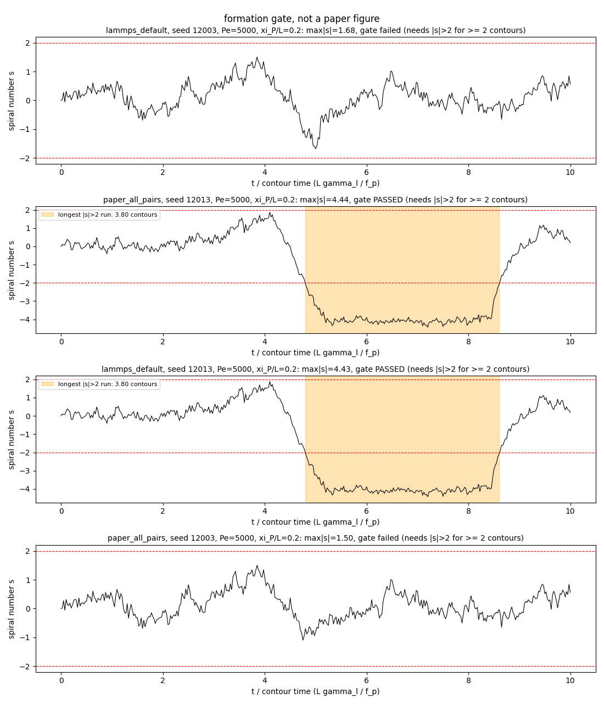

# Cadence note (2026-10-02)

**Started, not finished; not a replication.**

Tree: `spin-chain-paper-v2/spin-chain-paper-v2 (2).zip`, SHA-256 `c9333cc04415dadb6e7fe376348d859aa52721e277551bbd611979c9de952d7b` (matches). Its contents are identical to the working tree, excluding caches and `output/`.
κ, f_p, dt, noise and the force kernel are unchanged. dt = 5e-5 is unpublished. lammps_default remains a hypothesis.

## 0. Stopped the wrong job
The job was paper_all_pairs, **seed 12003**, cadence 0.01 τ.
- It was stopped first, at 2026-10-02 ~01:30 +05:30, with `Stop-Process -Id 21328`. Launcher 12856 exited with it, and no `paper-reproduce` process remains.
- It had reached step 78 780 000 (19.5 contours). Its last checkpoint is at step 50 500 000. It was **not resumed**.
- Its folder was renamed to `output/reproduction/STOPPED-paper_all_pairs-seed12003-wrong-seed/`, with a `STOPPED.txt` that says do not resume.

## 1. Unconfounded formation gate
Setup: strong_spiral (Pe = 5000, ξ_P/L = 0.2, N = 100), same integrator, 10 contours = 40 400 000 steps.
- One contour is L·γ_l/f_p = 202 time units.
- `sample_every` was 101 000 steps (0.025 contour), giving 401 frames with positions.
- Checkpoint at every frame.

The pass rule is unchanged and is the only test: consecutive saved frames with |s| > 2 lasting ≥ 2 contours, **and** stored COM == mean of stored positions with no reset.



| Policy | Seed | max \|s\| | Longest \|s\|>2 run | COM == mean(positions) | COM reset | Gate |
|---|---|---|---|---|---|---|
| lammps_default | 12003 (old) | 1.68 | none | yes | no | failed |
| paper_all_pairs | 12013 (old) | 4.44 | 3.80 contours, 153 frames, 4.8 → 8.6 | yes | no | **passed** |
| lammps_default | 12013 (new) | 4.43 | 3.80 contours, 153 frames, 4.8 → 8.6 | yes | no | **passed** |
| paper_all_pairs | 12003 (new) | 1.50 | none | yes | no | failed |

**Passing pairs:** (paper_all_pairs, 12013) and (lammps_default, 12013).

**The gate outcome follows the seed, not the policy.** For a given seed, both policies use the same noise stream, and their s(t) curves are nearly identical. The policies differ only in the WCA forces between beads at most 3 apart. Spiral contact happens beyond that separation, so the policy shifts the trajectory slightly but does not decide formation. This gate therefore gives **no evidence for either policy**; that choice still needs the original special_bonds line. Two seeds are not a formation rate.

**Zoomed film of the passing plateau:** `output/gate/plateau-paper_all_pairs-seed12013.gif`.
- It shows saved frames 192–344 (153 real frames, no interpolation, 80 ms per frame) in a lab-coordinate box ±17.2 r₀ around the wound chain.
- Tip black, COM trail red; s and t in contours are printed on each frame.
- Whole-run films and panels for all four runs are in `output/gate/`.

## 2. Code changes
- `cli.py`, `paper-reproduce`:
  - `--sample-every` accepts `<x>contour`, `<x>tau`, or integer steps. The default is **0.25 contour** (1 010 000 steps at Pe = 5000), replacing 0.01 τ. A 3.8-contour plateau is about 15 frames.
  - `--seed` sets the base seed (default: the preset seed). It was needed to run seed 12013 through the same resumable command.
  - The plan line now reports `sample_interval_contours`.
  - Segment-resume (`.from<step>.h5`, remaining steps only) and flush-before-checkpoint are unchanged.
- `src/spinchain/stitch.py` (new):
  - `read_segments(paths)` and `write_stitched(paths, out)` sort segments by step.
  - Consecutive segments must meet at exactly one shared frame, the checkpoint state, and that frame must have **bitwise-identical positions and COM** (the one-origin check). Fingerprint, origin convention, cadence and policy must also match.
  - A gap or an overlap is refused, not repaired. A restarted end-to-end-angle branch is shifted only by an exact multiple of 2π.
  - The output is a single schema-3 file that `analyze()` and `visualize()` read unchanged.
- `visualize.py`: `plateau_film()`, a zoomed film of a saved-frame range.
- `tests/formation_gate.py`: `--name` and `--no-films` options.
- Tests: **56 passed**. New tests:
  - default 0.25 contour, the `tau` unit, plain steps;
  - stitching three segments matches the uninterrupted run bitwise on every frame of the uninterrupted file;
  - stitch refuses a gap, an overlap, and a shifted origin;
  - `--seed`;
  - `plateau_film` uses only the requested saved frames.
- One test written last session was changed because the requirement changed: `test_default_sample_interval_is_one_hundredth_tau` became `..._is_quarter_contour`.

## 3. The 5τ job (one job only)
| | |
|---|---|
| Regime / policy / seed | strong_spiral / **paper_all_pairs** / **12013** |
| **PID** | interpreter **11268**, launcher 9568. Started 2026-10-02 01:38:22 +05:30, detached |
| Steps | **25 250 000 000** (5 τ = 1 262 500 time units = 6 250 contours) |
| Cadence | 1 010 000 steps = **0.25 contour** = 2e-4 τ, giving 25 001 frames with positions; checkpoint at every frame (≈ every 9 s) |
| Wall-clock estimate | 20 000-step benchmark, 113 034 steps/s (Verlet), gives **≈ 62 h (2.6 days)**. The earlier gate rate of ~1.2e5 steps/s gives ≈ 58 h |
| Output | `output/reproduction/paper_all_pairs-seed12013/strong_spiral-seed12013.h5` (+ `.checkpoint.npz`, `.angle.json`, `run.log`, `run.err`, `pid.txt`) |

The first progress line and the first checkpoint (step 2 020 000) were confirmed, with an empty stderr. Because the integrator is deterministic, the first 10 contours repeat the passing gate run exactly, at 0.25-contour cadence.

Launch command (tree root, `PYTHONPATH=src`):
```
python -m spinchain paper-reproduce --regime strong_spiral --policy paper_all_pairs --seed 12013 --tau 5 --replicates 1 --output-dir output/reproduction/paper_all_pairs-seed12013 --i-know
```
**Resume command**, after an interruption (tree root, `PYTHONPATH=src`). It writes `strong_spiral-seed12013.from<step>.h5` and runs only the remaining steps:
```
python -m spinchain paper-reproduce --regime strong_spiral --policy paper_all_pairs --seed 12013 --tau 5 --replicates 1 --output-dir output/reproduction/paper_all_pairs-seed12013 --i-know --resume
```
Stitch the segments after the job ends or is stopped. Do not read the `.h5` with h5py while the job is writing it.
```
python -c "import glob;from spinchain.stitch import write_stitched;print(write_stitched(glob.glob('output/reproduction/paper_all_pairs-seed12013/strong_spiral-seed12013*.h5'),'output/reproduction/strong_spiral-paper_all_pairs-seed12013-stitched.h5'))"
```
To stop the job: `Stop-Process -Id 11268`.

## Still open
- The gate cannot choose the policy, and seed decides formation over 10 contours. lammps_default and the ESI special_bonds line remain unresolved.
- dt = 5e-5 is unpublished.
- The analysis window must discard a transient explicitly.
- Only one seed, regime and policy is running. No second job was launched.

Started, not finished; not a replication.
