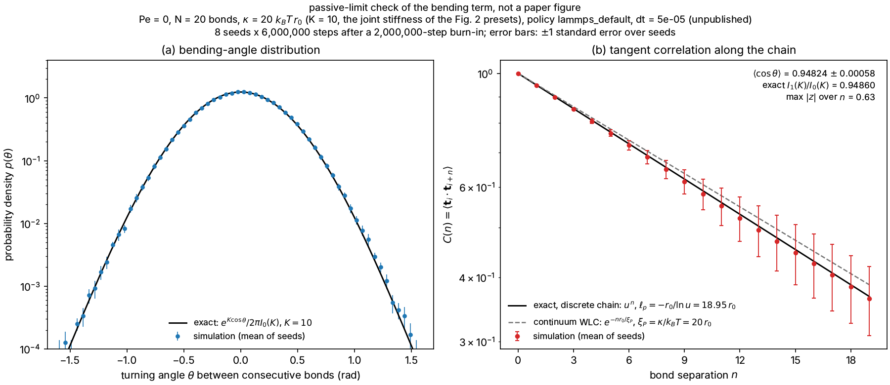
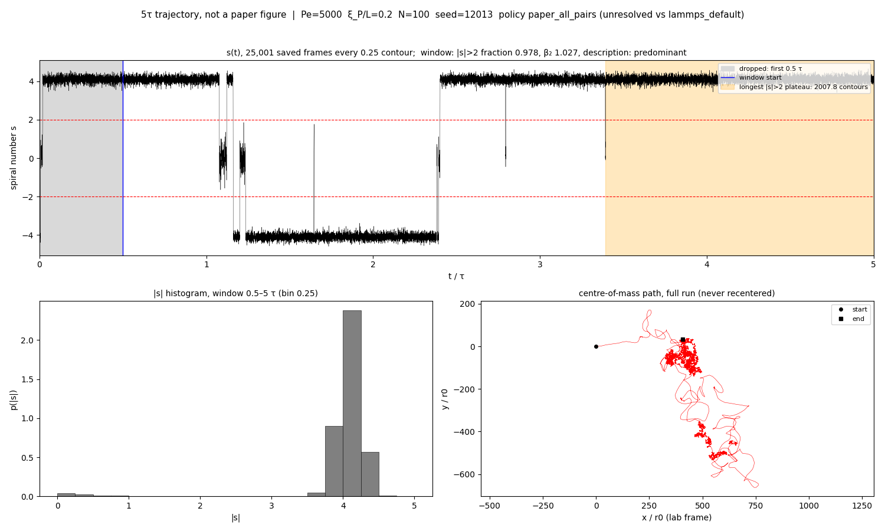

# spin-chain-models-simulator

[](https://github.com/s-siyanwal/spin-chain-models-simulator/actions/workflows/tests.yml)

Brownian-dynamics simulation of a **self-propelled worm-like filament** (an active polymer chain) in two dimensions, written in 2026 by Shivanshu Siyanwal as an audited reproduction toolkit for

> R. E. Isele-Holder, J. Elgeti, G. Gompper, *Self-propelled worm-like filaments: spontaneous spiral formation, structure, and dynamics*, Soft Matter **11**, 7181–7190 (2015), DOI [10.1039/c5sm01683e](https://doi.org/10.1039/c5sm01683e).

> [!IMPORTANT]
> **This is a model implementation and an in-progress reproduction attempt, not a completed replication of the paper.** So far one 5 τ trajectory exists, at one parameter point and one seed. See [What has and has not been shown](#what-has-and-has-not-been-shown). This repository also does not contain the code of the author's 2020 summer project; see [The 2020 summer project](#the-2020-summer-project).



*Code check, not a paper figure. With the active force switched off (Pe = 0), the simulated chain must reproduce the exact equilibrium statistics of a discrete worm-like chain. The chain has 20 bonds and the joint stiffness of the paper's Figure-2 presets. (a) The turning-angle distribution follows $`e^{K\cos\theta}/2\pi I_0(K)`$ over four decades. (b) The tangent correlation follows the exact discrete result $`C(n)=u^n`$, where $`u=I_1(K)/I_0(K)`$. At small $`n`$, where the error bars are smallest, it is clearly distinct from the continuum curve $`e^{-n r_0/\xi_P}`$. Measured $`\langle\cos\theta\rangle = 0.94824 \pm 0.00058`$ against the exact 0.94860; the largest $`|z|`$ over all separations is 0.63. Data: 8 seeds × 6×10⁶ steps after a 2×10⁶-step burn-in; regenerate with `python main.py wlc-check` (about 100 s).*

## Contents

- [Physics background](#physics-background)
- [The model](#the-model)
- [Quick start](#quick-start)
- [Reproducing the figures](#reproducing-the-figures)
- [What has and has not been shown](#what-has-and-has-not-been-shown)
- [Tests](#tests)
- [Repository layout](#repository-layout)
- [Guide to the notes](#guide-to-the-notes)
- [The 2020 summer project](#the-2020-summer-project) · [Authorship](#authorship) · [License](#license)

## Physics background

**Worm-like chains as spin chains.** A worm-like chain (the Kratky–Porod model) is an inextensible filament whose energy penalises bending; its tangent directions decorrelate over the persistence length $`\xi_P`$. Split into bonds $`\mathbf b_i`$ of length $`r_0`$, the bending energy couples neighbouring bond directions. In this code each joint costs

```math
\frac{\kappa}{4}\,\lvert\mathbf b_i-\mathbf b_{i+1}\rvert^2=\frac{\kappa r_0^2}{2}\,(1-\cos\theta_i),
```

which is a nearest-neighbour ferromagnetic coupling between the unit "spins" $`\mathbf t_i=\mathbf b_i/\lvert\mathbf b_i\rvert`$. In two dimensions a free chain of this kind is a classical XY spin chain, and its spin correlation is known exactly:

```math
\langle \mathbf t_i\cdot\mathbf t_{i+n}\rangle = u^n,\qquad u=\frac{I_1(K)}{I_0(K)},\qquad K=\frac{\kappa r_0^2}{2k_BT}.
```

For large $`K`$ the decay length $`-r_0/\ln u`$ approaches $`\xi_P-r_0`$, where $`\xi_P=\kappa/k_BT`$ is the continuum persistence length; at the paper's stiffness ($`K = 10`$) it is $`18.95\,r_0`$ against $`\xi_P = 20\,r_0`$. The figure above tests the simulator against these exact results.

**Self-propelled filaments.** Isele-Holder, Elgeti and Gompper add an active force of density $`f_p`$ that pushes such a filament along its own tangent, in two dimensions and without hydrodynamics. The behaviour is controlled by two numbers, the Péclet number $`\mathrm{Pe}=f_pL^2/k_BT`$ and the stiffness $`\xi_P/L=\kappa/(k_BTL)`$, where $`L`$ is the contour length. At high Pe the filament can spontaneously wind itself into a spiral. The spiral number $`s`$ (the total turning angle along the chain divided by $`2\pi`$) tracks this: $`s\approx 0`$ for an open chain, and the wound spirals of the 100-bond chain studied here have $`\lvert s\rvert\approx 4`$.

## The model

The package `spinchain` (`src/spinchain/`) integrates the overdamped Langevin equation of a chain of $`N+1`$ beads joined by $`N`$ bonds $`\mathbf b_i=\mathbf r_{i+1}-\mathbf r_i`$, with free ends:

```math
\gamma\,\dot{\mathbf r}_i=-\nabla_i\left(U_\mathrm{bond}+U_\mathrm{bend}+U_\mathrm{WCA}\right)+\mathbf F^{p}_i+\boldsymbol\eta_i(t),\qquad
\langle\eta_{i\alpha}(t)\,\eta_{j\beta}(t')\rangle=2\gamma k_BT\,\delta_{ij}\,\delta_{\alpha\beta}\,\delta(t-t'),
```

```math
U_\mathrm{bond}=\frac{k_S}{2}\sum_i\left(\lvert\mathbf b_i\rvert-r_0\right)^2,\qquad
U_\mathrm{bend}=\frac{\kappa}{4}\sum_i\lvert\mathbf b_i-\mathbf b_{i+1}\rvert^2,\qquad
U_\mathrm{WCA}=\sum_\mathrm{pairs}4\epsilon\left[\left(\frac{\sigma}{r}\right)^{12}-\left(\frac{\sigma}{r}\right)^{6}\right]+\epsilon\quad(r<2^{1/6}\sigma).
```

- **Active force.** Each bond contributes $`f_p\,\mathbf b_i`$, split equally between its two beads (the paper's Eq. 7, not normalised). Code bead $`N`$ leads, which is paper bead 1; `analysis.paper_bead_to_code` maps between the two numberings.
- **Integration.** Euler–Maruyama with a compiled Numba kernel and a skin-based Verlet neighbour list. The noise is counter-based (it depends only on seed, step and bead), so chunked and resumed runs are bitwise identical to uninterrupted ones. Checkpoints are atomic and fingerprinted. HDF5 output (schema 3) stores lab-frame positions that are never recentred, plus an unwrapped end-to-end angle.
- **Units and fixed values.** $`r_0=\gamma=k_BT=1`$; $`k_S=4000\,k_BT/r_0^2`$, $`\sigma=r_0`$, $`\epsilon=k_BT`$. Time is measured in units of $`\gamma r_0^2/k_BT`$. The code refuses $`r_0\neq1`$, because Eq. 4 is written in those units.
- **Time step.** $`\Delta t = 5\times10^{-5}`$ is the code's stability guard $`0.2\,\gamma/k_S`$. It is **not** the paper's value, which is given only in the paper's ESI and is unknown here; every output file records this.
- **Time scales.** With $`\gamma_l=\gamma(N+1)/L`$: the paper's time scale $`\tau=L^3\gamma_l/4k_BT`$, and the contour time $`L\gamma_l/f_p`$ (the time to travel one chain length at the contour speed $`f_p/\gamma_l`$).

The three presets are the paper's Figure-2 points:

| preset | Pe | ξ_P/L | N | κ (k_BT r₀) | f_p (k_BT/r₀) | contour time | seed |
|---|---|---|---|---|---|---|---|
| `polymer` | 200 | 0.2 | 100 | 20 | 0.02 | 5050 | 12001 |
| `weak_spiral` | 1000 | 0.2 | 100 | 20 | 0.1 | 1010 | 12002 |
| `strong_spiral` | 5000 | 0.2 | 100 | 20 | 0.5 | 202 | 12003 |

For all three, τ = 252 500 time units, so a 5 τ run is 2.525×10¹⁰ steps.

**Excluded-volume policy.** The paper prints its WCA sum over all pairs (Eq. 5) but ran LAMMPS, whose default `special_bonds` setting skips near neighbours. The authors' actual setting is unknown, so the code offers four policies. Each is stored in every output file and its fingerprint:

| policy | WCA pairs skipped (separation along the chain) | status |
|---|---|---|
| `paper_all_pairs` | none | the printed Eq. 5 |
| `exclude_12` | 1 | variant |
| `exclude_12_13` | 1, 2 | variant |
| `lammps_default` (default) | 1, 2, 3 | hypothesis: LAMMPS `special_bonds lj 0 0 0` assumed |

**Analysis** reads only the HDF5 file. It computes:
- the spiral number and its symmetrized kurtosis β₂;
- ⟨r_e²⟩ compared with Kratky–Porod;
- the centre-of-mass MSD and the mean-square rotation;
- the "railway" MSD of one bead relative to another;
- the dynamic structure factor S(q, t).

An optional Taichi/Vulkan backend (`requirements-gpu.txt`) is experimental and never selected automatically.

## Quick start

Python 3.11 (the pins in `requirements.txt` target it):

```bash
python3.11 -m venv .venv && source .venv/bin/activate
pip install -r requirements.txt
PYTHONPATH=src python -m pytest -q                      # 127 tests, about 15 s
```

A short integrity run (4 000 steps, about a second; outputs go to the git-ignored `output/`):

```bash
PYTHONPATH=src python tests/smoke_integrity.py --regime polymer --steps 4000 --sample-every 100
```

A longer headless run and its analysis:

```bash
PYTHONPATH=src python main.py headless --regime polymer --steps 100000 --sample-every 5000 --output output/polymer-smoke.h5
PYTHONPATH=src python main.py analyze output/polymer-smoke.h5 --structure
```

All subcommands: `python main.py {benchmark,paper-audit,headless,paper-reproduce,analyze,visualize,wlc-check,hardware,vulkan-probe}`. `paper-audit` estimates the cost of a full run before launching one; `paper-reproduce` refuses to start without `--i-know`. Windows-specific setup (`setup.ps1`) is described in [`ORIGINAL_TOOLKIT_README.md`](ORIGINAL_TOOLKIT_README.md).

## Reproducing the figures

| Output | How to regenerate | Cost | What it is |
|---|---|---|---|
| `results/validation/passive_wlc_check.{png,json}` | `PYTHONPATH=src python main.py wlc-check` | about 100 s | Code check against exact results. On the same platform and package versions the rerun is bitwise identical. |
| [`notebooks/reproduce.ipynb`](notebooks/reproduce.ipynb) | `pip install -r requirements-notebook.txt`, then `jupyter execute notebooks/reproduce.ipynb` | about 2 min | Reruns the check above and compares it with the committed JSON, runs an integrity trajectory, and reads back the 5 τ verdict. CI executes it on every pull request. |
| `results/gate/*` | the commands in [`PRODUCTION_NOTE.md`](PRODUCTION_NOTE.md) and [`CADENCE_NOTE.md`](CADENCE_NOTE.md), then `python tests/formation_gate.py RUN.h5 ...` | 5–6 min per 10-contour run on the original laptop | Formation gate: an integrity check, not a result. A different platform may not reproduce the same trajectory bitwise. |
| `results/reproduction/*` | needs the 5 τ trajectory, which is not in git: the stitch, verdict and figure commands at the end of [`RESULT_NOTE.md`](RESULT_NOTE.md) | several days of CPU for the trajectory | The one 5 τ trajectory, summarised below. |

## What has and has not been shown



*One trajectory, not a paper figure: `strong_spiral` (Pe = 5000, ξ_P/L = 0.2, N = 100), seed 12013, policy `paper_all_pairs`, 5 τ = 2.525×10¹⁰ steps. The first 0.5 τ is dropped as a transient (grey).*

From the toolkit's own notes ([`RESULT_NOTE.md`](RESULT_NOTE.md), [`VERDICT_PLAN.md`](VERDICT_PLAN.md), [`CADENCE_NOTE.md`](CADENCE_NOTE.md), [`AUDIT.md`](AUDIT.md)):

- **Shown, for this one trajectory.** Over the 0.5–5.0 τ window (22 501 samples):
  - the fraction of samples with |s| > 2 is 0.978, and the symmetrized β₂ is 1.027;
  - the longest |s| > 2 plateau is 2007.75 contours, still running when the run ended, so it is a lower bound;
  - the centre-of-mass MSD has a log-log slope of 1.001;
  - there is no unit-slope region in the mean-square rotation, so no rotational diffusion constant is reported.

  By the pre-registered rules this trajectory is described as "predominant", **on this seed only**.
- **Shown for the code.** The passive limit reproduces the exact discrete worm-like-chain statistics (the figure at the top), and 127 tests check the force law, the noise, the integrator's determinism and the analysis.
- **Not shown.** Seed-to-seed behaviour: another gated seed (12003) formed no spiral in 10 contours under either policy. Pe = 200 and 1000 were not run at paper length. No figure of the paper, and no phase diagram, has been reproduced quantitatively.
- **Still open.** The excluded-volume policy, the paper's time step and its `special_bonds` setting. The 10-contour gate showed that formation followed the seed, not the policy, so it cannot choose between policies.

Apart from the passive-limit check of the code, every run in this repository that is shorter than 5 τ is an integrity test, not a result.

## Tests

`PYTHONPATH=src python -m pytest -q` runs 127 tests in about 15 s. CI runs them, plus a second job that executes the reproduction notebook. Statistical tests use fixed seeds, so they are deterministic, with tolerances of several standard errors.

| Area | Examples |
|---|---|
| Force law | numerical gradient of the energy; zero net force and torque; WCA value at σ and continuity at the cutoff; each exclusion policy counting exactly its pairs |
| Noise and integrator | counter-RNG moments and independence; exact centre-of-mass diffusion, with variance 2k_BT t/(γ(N+1)) per component; the active force driving the centre of mass at exactly f_p R_e/(γ(N+1)); Boltzmann bending statistics |
| Determinism and integrity | chunk, resume and stitch bitwise equal to uninterrupted runs; Verlet list against the all-pairs reference; refusal of incomplete, recentred, mismatched or corrupt files |
| Observables | analytic and synthetic-trajectory checks of the spiral number, kurtosis, MSD, MSR, S(q, t), Kratky–Porod, tangent correlation and turning angles |
| Verdict and CLI | description rules at their boundaries, sample-interval parsing, `paper-reproduce` refusal without `--i-know` |

## Repository layout

| Path | Contents |
|---|---|
| `src/spinchain/` | simulator, forces, engine, RNG, analysis, observables, I/O, stitching, CLI, `validation.py` (passive-limit check) |
| `tests/` | the pytest suite, plus the driver scripts `smoke_integrity.py`, `formation_gate.py`, `verdict.py` and `result_figures.py` (not collected by pytest) |
| `notebooks/reproduce.ipynb` | reproduction notebook (executed; outputs committed) |
| `results/` | small outputs: `validation/` (passive check), `gate/` (formation gate), `reproduction/` (5 τ verdict and panel) |
| `reports/` | LaTeX sources and PDFs of a "beginner" and an "expert" write-up |
| `main.py`, `config/`, `setup.ps1`, `tools/` | entry point, presets, Windows helpers |
| `*_NOTE.md`, `AUDIT.md`, `VERDICT_PLAN.md`, `docs/` | dated working notes and the replication plan (see below) |
| `CITATION.cff`, `LICENSE`, `CHANGELOG.md`, `AGENTS.md` | citation metadata, licence, changes since the notes, maintainer rules |

## Guide to the notes

The notes are dated session records (30 September – 5 October 2026), kept as written. Changes made after them are listed in [`CHANGELOG.md`](CHANGELOG.md). A sensible reading order:

1. [`AUDIT.md`](AUDIT.md): what the model fixes, what the paper leaves open, and why the CPU kernel is the default.
2. [`REPRO_NOTE.md`](REPRO_NOTE.md): the origin convention, the index convention, and how every observable is computed.
3. [`CADENCE_NOTE.md`](CADENCE_NOTE.md): the formation gate across policies and seeds, and the launch of the 5 τ job. It supersedes [`PRODUCTION_NOTE.md`](PRODUCTION_NOTE.md).
4. [`VERDICT_PLAN.md`](VERDICT_PLAN.md): the pre-registered verdict rules, written before the result.
5. [`RESULT_NOTE.md`](RESULT_NOTE.md): the 5 τ verdict and its limits.
6. [`VIZ_NOTE.md`](VIZ_NOTE.md) (films and panels) and [`docs/REPLICATION_PLAN.md`](docs/REPLICATION_PLAN.md) (the tiers a full replication would need).

[`reports/expert/report_expert.pdf`](reports/expert/report_expert.pdf) and [`reports/beginner/report_beginner.pdf`](reports/beginner/report_beginner.pdf) cover the same work as continuous write-ups. [`AGENTS.md`](AGENTS.md) holds the maintainer rules, for example "never call a short capped run a paper replication".

## Not included (left out of git)

- HDF5 trajectories: the stitched 5 τ file (about 33 MB), its raw segment (about 32 MB), smoke and gate trajectories, `.npz` checkpoints and `.gif` animations (the largest about 7 MB). They stay with the original working tree.
- The original paper PDF and its arXiv source (copyrighted; fetch them from the DOI above).
- An earlier prototype (`active-polymer-simulator` v1.1–v1.5) and AI-prompt and draft files from the same folder.
- The toolkit's original `LICENSE`, `CITATION.cff` and `MANIFEST.json`. See [Authorship](#authorship).

## The 2020 summer project

In summer 2020 the author did a project with Abhishek Chaudhuri on worm-like spin chain models. That project's code and results are not in this repository, and nothing here reconstructs them. The toolkit above is separate work, written in 2026, on a related topic: the worm-like chain and its spin-chain form, here with an active force added.

## Authorship

This toolkit is Shivanshu Siyanwal's own work, written in 2026. The toolkit's original `LICENSE` and `CITATION.cff` files, which are not in this repository, named Akanksha Singh; that name is not an authorship claim. The author is credited in [`CITATION.cff`](CITATION.cff), `pyproject.toml`, [`LICENSE`](LICENSE) and on the title pages of the two reports in `reports/`.

To cite this software, use [`CITATION.cff`](CITATION.cff) (GitHub's "Cite this repository" button), and please also cite the paper whose model it implements.

## License

MIT, see [`LICENSE`](LICENSE).
